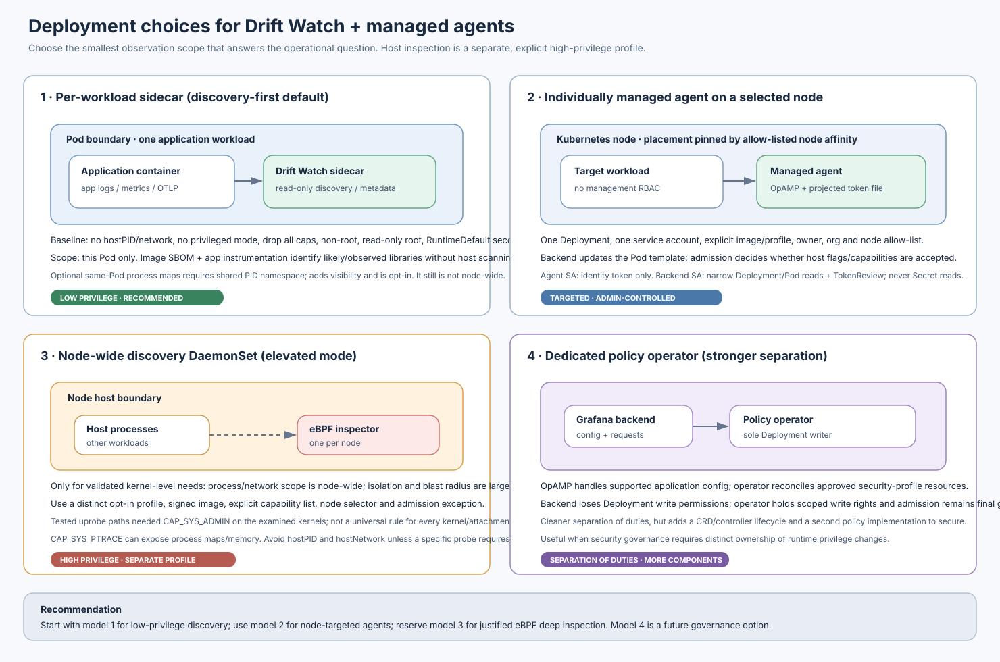
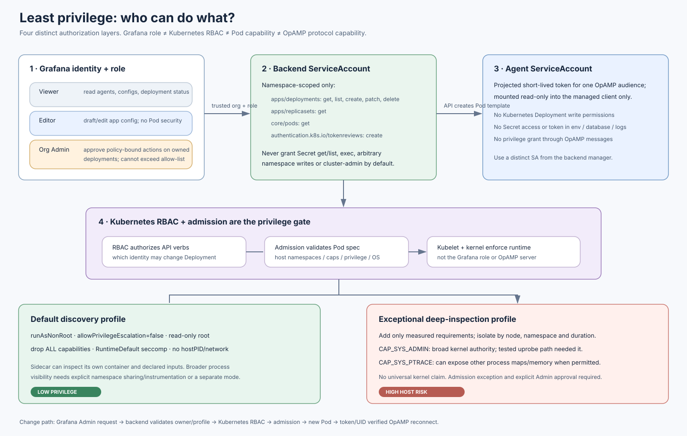
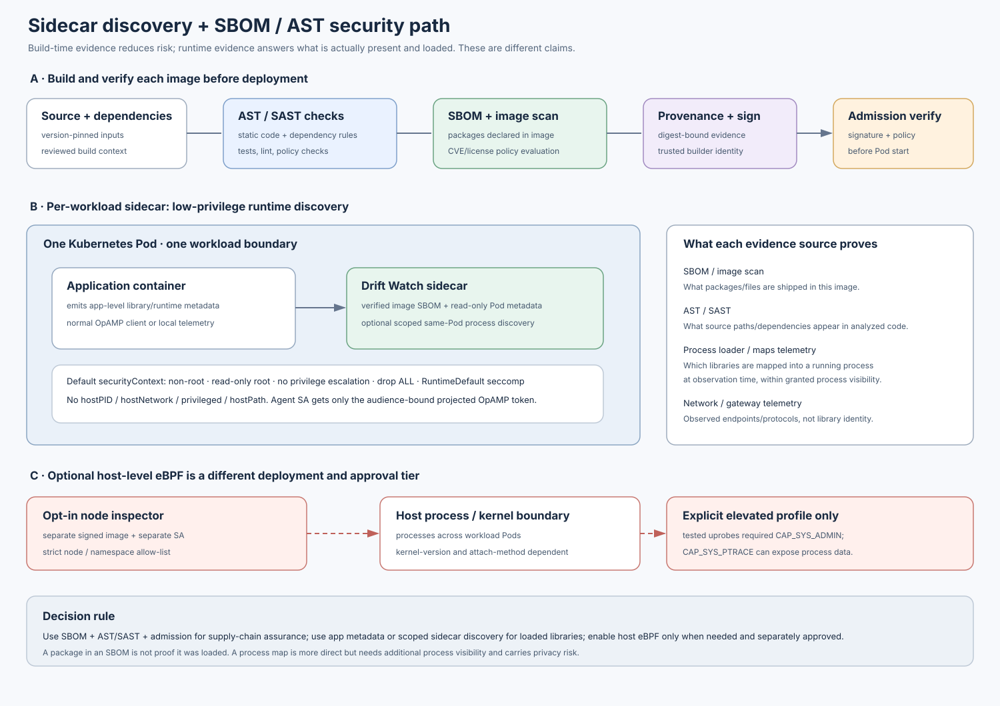
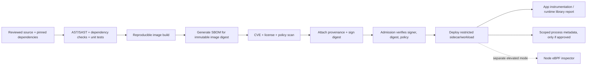

# Agent deployment models and least-privilege discovery

This document makes the deployment and observation choices explicit. The
recommended default is low-privilege per-workload discovery. A node-wide eBPF
inspector is a distinct opt-in product/security profile; it is not the default
sidecar with a few extra flags.

## Deployment model choices

| Model | Observation scope | Pod / host privileges | Management permissions | Best fit |
|---|---|---|---|---|
| Per-workload sidecar | One Pod; image metadata, app signals, explicitly declared read-only inputs | Restricted Pod: no host namespaces, privileged flag or added caps; share PID namespace only when a documented same-Pod process need exists | No Kubernetes API write permissions. Project only a short-lived OpAMP-audience token into the sidecar | Default library/runtime discovery and local status |
| Individual agent Deployment | One allow-listed agent on a selected node | Restricted by default; can use an Admin-selected allow-listed Pod security profile | Backend manages this Deployment; agent ServiceAccount remains identity-only | Node affinity, lifecycle and configuration management for a specific agent |
| Node-wide eBPF DaemonSet | Processes / events across the node, dependent on kernel and attachment mechanism | Explicit capabilities and mounts may be required; exceptional host-level risk | Separate workload, image, node allow-list, admission exception and approval | Deep kernel/process/TLS inspection when lower-privilege evidence is insufficient |
| Dedicated policy operator | Same agent scope as above; changes only approved policy resources | Operator reconciles approved Pod templates; admission is still final | Operator, not the Grafana backend, holds Deployment write permission | Stronger separation of duties; accepts added CRD/controller complexity |

### Least-privilege application security context

The low-privilege profile should use `runAsNonRoot`, `allowPrivilegeEscalation:
false`, a read-only root filesystem, `capabilities.drop: ["ALL"]`, and
`seccompProfile.type: RuntimeDefault`. It should not set `hostPID`,
`hostNetwork`, `hostIPC`, `privileged`, host paths, or Windows HostProcess. Add
only narrowly justified writable scratch space as an explicit `emptyDir` with
resource limits. Restrict outbound traffic to the OpAMP endpoint and required
telemetry destinations with NetworkPolicy where supported.

Do not make a sidecar cluster-wide by giving it broad Pod list/watch rights.
If inventory discovery outside its Pod is needed, use a separate backend or
controller identity with read-only resource scope. Keep deployment write
permissions out of agent containers.

### Who receives Kubernetes permissions?

| Principal | Minimum permissions / authority | Must not receive |
|---|---|---|
| Grafana Viewer | Org-scoped API reads | Config edits or deployment operations |
| Grafana Editor | App-config draft/edit routes per app RBAC | Deployment create/patch/delete or privilege profile changes |
| Grafana Org Admin | Owned deployment lifecycle and allow-listed profile selection | Arbitrary Pod specs, arbitrary namespaces, RoleBinding/SA changes |
| Fleet backend ServiceAccount | Namespaced Deployment `get/list/create/patch/delete`; ReplicaSet and Pod `get`; TokenReview `create` | Secret reads, exec, node writes, cluster-admin |
| Agent/sidecar ServiceAccount | Bound, audience-scoped projected identity token, mounted only in client | Kubernetes API write, Secret access, token creation, capability grants |
| Admission controller / platform policy | Enforce Pod Security Standards and the organization's explicit exception list | Trusting a Grafana role as a bypass |

Kubernetes RBAC decides who may modify a Deployment; admission decides whether
the requested Pod security fields are allowed; the kernel enforces the accepted
runtime. OpAMP can configure supported application settings and request
client-advertised operations, but cannot grant Kubernetes RBAC or Linux
capabilities.

## SBOM, AST/SAST, and identifying what is running

Use the evidence source that matches the claim:

1. **SBOM + image scan**: identifies packages and files included in a particular
   image digest and known vulnerabilities/licenses. It does not prove a package
   was loaded in a particular process.
2. **AST/SAST and dependency analysis**: evaluates source/dependency patterns
   and build inputs. It predicts/flags code paths; it is not live runtime
   evidence. Here AST means application security testing; include AST/SAST,
   dependency, container-image and policy checks in the CI pipeline.
3. **Application/supervisor instrumentation**: can report the process's actual
   runtime, TLS library and loaded modules with the clearest app-level context
   and generally avoids cross-process inspection.
4. **Scoped sidecar process metadata**: can inspect only its allowed view. A
   sibling-container view generally requires a shared Pod PID namespace and
   compatible UID/proc access controls; this exposes more process metadata and
   must be opt-in. It is not a node-wide view.
5. **Host eBPF/process inspection**: can provide deeper node/process evidence,
   but attachment permissions vary by kernel and mechanism. In Drift Watch's
   tested Lima cases, the tested OpenSSL uprobe path required `CAP_SYS_ADMIN`;
   this observation is not a universal rule. `CAP_SYS_PTRACE` may reveal other
   processes' maps or memory and has a substantial privacy/security impact.

### Supply-chain pipeline

Pin images by digest, store SBOM/provenance with the build artifact, and have
admission verify the digest/signature at deploy time. Do not place credentials
inside image labels or SBOM metadata. Keep runtime observations separately
timestamped and identify their source and scope (image, process, Pod, or node).

The current repository implements the Grafana role separation, Deployment
security profiles, per-Deployment management, and authenticated managed OpAMP
enrollment. It does **not** yet build/sign images, generate SBOMs, run AST/SAST,
enforce signature admission, or implement a generic AI/MCP/model-specific
process scanner. Those are explicit future work, not capabilities implied by
the current UI. See the [MySQL relationship graph](MYSQL_SCHEMA.md) for the
single-schema data model and [control-plane overview](CONTROL_PLANES_AND_DRIFTWATCH.md)
for permission architecture alternatives.
