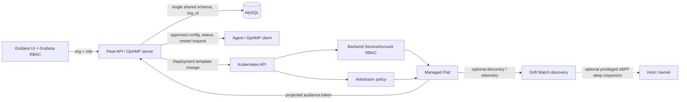

# Fleet control planes, permissions, and Drift Watch boundary

## What is implemented

The Grafana workflow creates and manages allow-listed Kubernetes agent Deployments. The backend enrolls an agent using an audience-bound projected service-account token, verifies the TokenReview identity and the Pod → ReplicaSet → Deployment UID chain, and binds that workload to a durable fleet enrollment and Grafana organization. The OpAMP identity is server-owned; caller labels and tenant headers cannot choose it. Config offers and acknowledgements are scoped to that identity. A security-profile edit changes a Kubernetes Deployment template and is applied only by Kubernetes after RBAC and admission checks; OpAMP itself does not grant Linux capabilities or change host namespaces.

The application uses one MySQL database/schema shared by all Grafana organizations. `org_id`, Grafana-org mapping, ownership checks, and API RBAC provide the application boundary. Because this is a new, unreleased app, the old incremental files were consolidated into `0001_initial_schema.sql`; no production database or customer data was merged or altered. The local initializer refuses databases that already have tables. See the [MySQL ER graph](MYSQL_SCHEMA.md).

## Architecture choices

| Model | Who applies Pod privilege changes? | Strength / trade-off |
|---|---|---|
| Central fleet backend (implemented) | Backend service account patches an allow-listed Deployment profile; admission policy is final gate. | One UI/control plane; backend RBAC is sensitive and should be namespace-scoped. |
| Dedicated Kubernetes operator | OpAMP manages app config; operator reconciles security-profile resources and owns Deployment writes. | Cleaner separation of duties; adds operator and CRD lifecycle. |
| Agent-only / platform-managed | OpAMP manages supported app config; platform team alone provisions Pod security. | Smallest backend privilege; no self-service Pod privilege changes in Grafana. |

## Permission assignment

| Principal / role | Allowed | Explicitly not allowed |
|---|---|---|
| Grafana Viewer | Read agents, deployments, profiles, and configs in mapped org. | Change config, restart, deploy, or select privilege. |
| Grafana Editor | Draft/update application config subject to approval policy. | Kubernetes deployment/security changes or lifecycle operations. |
| Grafana Org Admin | Manage owned deployments and choose only configured security profiles; request supported config/restart operations. | Exceed profile allow-list or Kubernetes admission policy. |
| Platform operator | Set namespace, node/service-account allow-lists, profile catalog, backend RBAC, admission policy. | No need to hand backend cluster-admin. |
| Backend ServiceAccount | Namespace-scoped Deployment get/list/create/patch/delete, ReplicaSet/Pod get, and TokenReview create. | Read Secrets; cluster-admin; arbitrary namespace writes. |
| Agent ServiceAccount | Dedicated projected token for the OpAMP audience (identity only). | Deployment writes, TokenReview, Secret reads, or capability escalation. |
| Kubernetes admission/runtime | Enforce hostPID/hostNetwork/privileged/capability/Windows HostProcess policy. | Treating Grafana role as a substitute for cluster enforcement. |

OpAMP can send configuration supported by the client and request operations the client advertises. It cannot mutate the Pod's Linux capabilities, `hostPID`, `hostNetwork`, `privileged`, or Windows HostProcess from inside the protocol. Those belong to the Kubernetes Deployment/Pod security context and require backend Kubernetes RBAC plus admission approval. Capability profiles are materially security-sensitive: an eBPF deep-inspection profile may require `CAP_SYS_ADMIN` on tested attachment paths, and process inspection with `CAP_SYS_PTRACE` can expose other processes' memory/maps. Keep discovery-only and deep-inspection profiles separate, opt-in, and narrow.

## Safety and verification boundary

- Projected tokens are read from a file at connection time; token values are not stored in the database or emitted in logs.
- Backend Pod reads expose Pod specifications (which may contain plaintext environment values). Restrict namespace and identities; do not grant Secret reads.
- Admission policy must independently reject unapproved host namespaces, privileged mode, capabilities, and HostProcess.
- The implementation's automated tests use fake TokenReview/Kubernetes responses. Go race tests and vet pass; no real cluster, real projected-token rotation, actual client/server WSS exchange, or admission controller was exercised.
- The reference managed client is a protocol/authentication example that emits synthetic health; it does not implement Collector config apply/restart. Support must be implemented in each real agent/supervisor before offering those actions.
- This repository's Docker Compose no longer mounts the host `~/.kube/config` or `kubectl` into Grafana. Demo collectors are opt-in under the `demo` profile. These changes reduce local exposure and idle resource use; no cloud-cost savings are claimed.

For the eBPF compatibility observations and kernel-version matrix, see [the Drift Watch Lima report](../../driftwatch-lima-validation/report/DRIFTWATCH_LIMA_CAPABILITY_REPORT.md) and [process identity report](../../driftwatch-lima-validation/report/PROCESS_AI_MCP_IDENTITY_REPORT.md). Those are observed test results, not a universal Linux-kernel guarantee. No claim is made here that every kernel below/at/above 5.8 or every attachment method has been tested.
