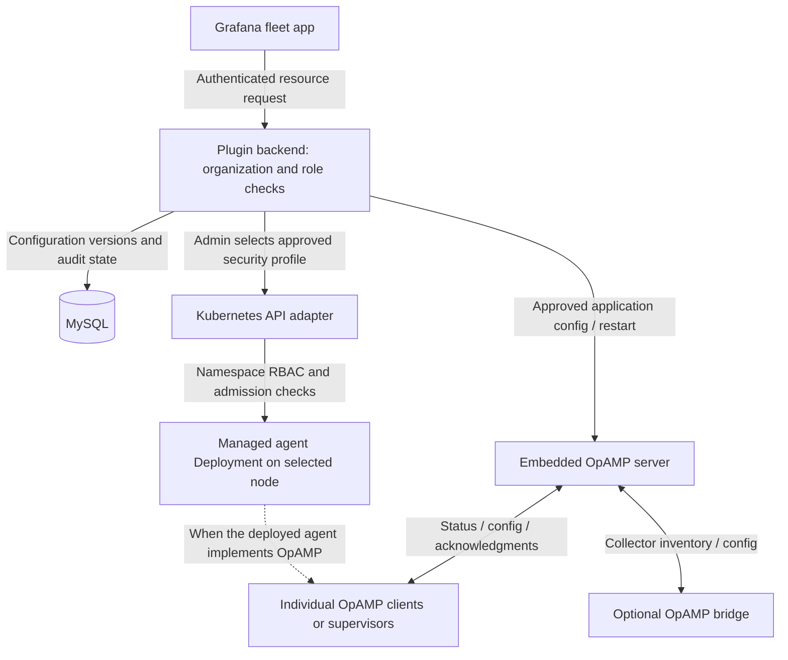

# Combined agent configuration and deployment control

One Grafana app presents both agent configuration and Kubernetes deployment controls. The plugin backend authorizes each request using Grafana's trusted organization role and explicitly mapped fleet organization. OpAMP and Kubernetes execute different parts of the same management workflow.



The running local test topology is Grafana on host port 3001, with the plugin backend hosting OpAMP on container port 4321, and a separate MySQL container. Synthetic clients connect over an isolated Docker network. The Kubernetes adapter is disabled in that topology because no deployment allowlist or in-cluster identity has been configured. No real cluster deployment is implied by a successful synthetic adapter test.

## Unified workflow and remaining integration

The intended product is one selected-agent workflow, not two unrelated management tools:

1. Admin selects an allowed node, runtime and security profile to deploy an agent.
2. An authenticated enrollment binds the deployment's stable fleet ID and Kubernetes identity to that agent's OpAMP identity.
3. The same agent view shows application config/status, node placement, desired security profile and rollout state.
4. Editor modifies application config only; Admin changes approved deployment/security policy. Both operations authorize the same organization and target.
5. A security change rolls out the pod; subsequent connection/config acknowledgments establish that the replacement agent is communicating. Desired, accepted and effective state are shown separately.

The app now binds the managed deployment to a stable server-owned OpAMP identity through durable enrollment. A short-lived audience-bound projected token is checked using TokenReview and the exact Pod → ReplicaSet → Deployment UID chain. Replacement pods must match the same enrolled Deployment UID and current approved security-profile hash. This association is covered by fake Kubernetes/TokenReview tests, not a live WSS or cluster test. Kubernetes rollout and OpAMP config delivery remain separate operations, not an atomic transaction; failures must be surfaced independently. See [managed enrollment details](MANAGED_OPAMP_ENROLLMENT.md).

| User | Agent application configuration | Agent deployment/security |
| --- | --- | --- |
| Viewer | Read current config, history, status | Read managed deployment/template state |
| Editor | Generate/save/revert drafts; push the exact Admin-approved config | Cannot create/change deployment or security profile; cannot export deployment CRDs |
| Organization Admin | Approve/reject drafts; request supported restart | Create/manage owned deployments; select a permitted security profile |
| Platform operator | Configure app deployment and enrollment | Define allowed namespace, nodes, runtime/security profiles and Kubernetes admission/RBAC |

## What is managed

Individual OpAMP clients report inventory/status and accept supported application configuration. An OpenTelemetry Collector may use an OpAMP extension or supervisor. A bridge can represent several collectors through one connection. Generic agents, including an AI or MCP agent, need an implemented OpAMP client/supervisor adapter before their application configuration can be managed through OpAMP. Deployment alone does not add that support. The current config builder is Collector-specific; arbitrary agent config schemas are not implemented by this builder.

The Kubernetes deployment adapter manages one-replica Deployments created by this app in the configured namespace, owned by the authenticated login and organization. Required node affinity selects one allowed node. It does not automatically take control of every existing Pod, DaemonSet, operator CRD, or agent in a cluster. OpAMP inventory and Kubernetes deployment IDs remain separate until an authenticated association exists. The UI reports unassociated OpAMP state as **Not verified**, and accepted pod-template security separately from rollout completion.

## Permissions needed to change host access

For this architecture the **plugin backend service account**, rather than each ordinary agent, needs namespaced Kubernetes deployment permissions:

```yaml
apiVersion: rbac.authorization.k8s.io/v1
kind: Role
metadata:
  name: fleet-deployment-manager
  namespace: agent-runtime
rules:
  - apiGroups: [apps]
    resources: [deployments]
    verbs: [get, list, create, patch, delete]
```

A platform operator must bind this Role to the backend service account. This is an example only and is not applied by the setup commands. The adapter does not require permissions to read Secrets, modify RoleBindings, exec into Pods, or read Nodes. Kubernetes RBAC grants operations on resources; it does not independently restrict which pod security settings those operations can request. Pod Security Admission, an admission webhook, or another cluster policy must enforce permitted settings. A restricted namespace can reject host namespace sharing, added capabilities, privileged Linux containers, or Windows HostProcess even when the API caller may patch Deployments.

Security profile changes patch the desired pod template and cause an active Deployment to replace its Pods. Stopped deployments keep zero replicas. Agent application config changes travel through OpAMP and depend on the client's advertised capabilities. Neither an OpAMP message nor a Grafana Admin role creates a Linux capability or a Kubernetes RoleBinding. An optional custom OpAMP controller that performs Kubernetes changes would itself need the corresponding service-account permissions, shifting that authority into the controller.

## OpAMP extension assessment

The current upstream specification includes `CustomCapabilities` and `CustomMessage`, marked **Development**, for negotiated vendor extensions. It does not define a built-in pod security-profile or Kubernetes privilege-grant command. The reviewed public upstream issue search did not reveal a committed feature or release date for hostPID/hostNetwork/capability management. Protocol capability updates, such as the change discussed in [PR 217](https://github.com/open-telemetry/opamp-spec/pull/217), describe supported protocol behavior, not Linux capability grants.

Keep the standard OpAMP wire protocol for existing clients. The combined app can add a vendor-namespaced policy/status message later if a separately deployed management controller needs it; that extension would need negotiation, versioned payloads, authentication, target ownership checks and controller-side enforcement. It would not remove Kubernetes authorization or admission checks. There is no need to fork the OpAMP specification to support the current centralized deployment adapter.

Sources: [OpAMP specification](https://opentelemetry.io/docs/specs/opamp/), [Kubernetes RBAC](https://kubernetes.io/docs/reference/access-authn-authz/rbac/), [Pod Security Standards](https://kubernetes.io/docs/concepts/security/pod-security-standards/).

## Verification and release boundaries

`make test-agent-privileges` exercises role boundaries, profile selection, request injection and manifest/patch constraints with synthetic adapters. `make test-safe` runs backend race tests and non-browser frontend tests. Browser component tests are separately opt-in through `make test-browser`; no browser access is needed by the default test workflow.

The synthetic OpAMP fixture proved direct/bridge-classified connection and effective-config reporting. An approved remote-config offer/acknowledgment and restart were not exercised in that fixture. Real cluster admission, Windows runtime behavior, authenticated deployment-to-OpAMP identity association, and production OpAMP enrollment authentication require separate verification before a production rollout. See [the protocol evidence](OPAMP_E2E.md) and [privilege test report](AGENT_PRIVILEGE_TEST_REPORT.md).
