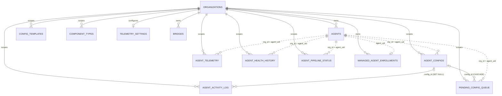
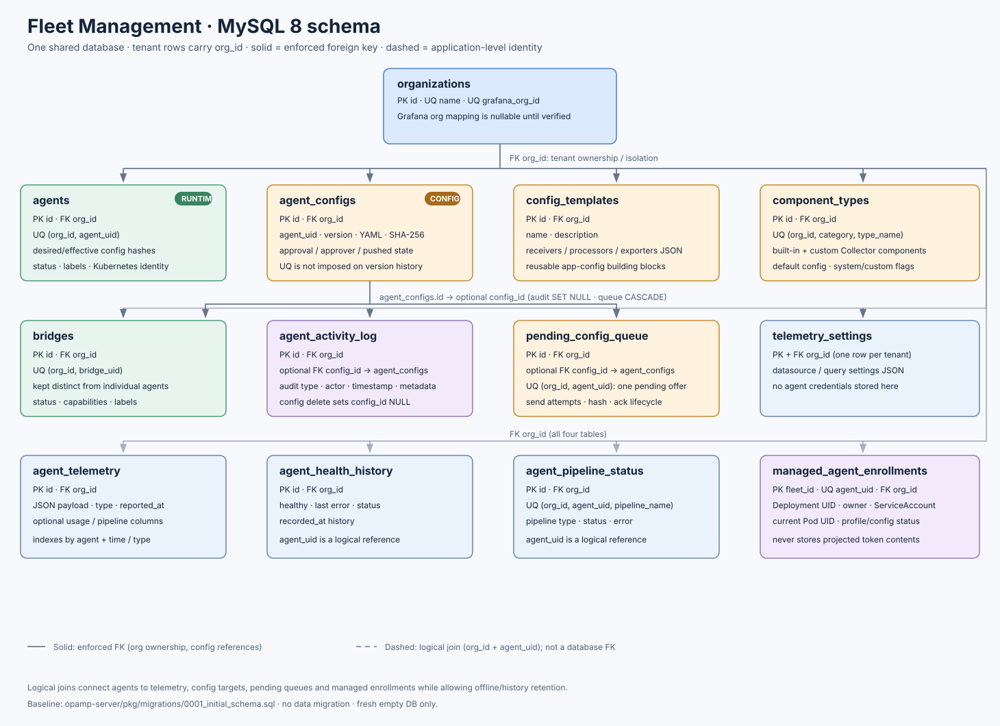

# MySQL schema and relationship graph

The app stores fleet data in **one MySQL 8 database**. Grafana's own internal
database is a separate Grafana service concern; it is not part of this schema.
Tenant ownership is explicit: each tenant row has an `org_id` foreign key to
`organizations`, and backend queries also scope reads and writes by `org_id`.

## Entity relationship diagram

Solid links are database foreign keys. Dashed links are logical identifiers
used by the application but deliberately not enforced as foreign keys because
telemetry, enrollment and offline history may outlive an inventory row.

## Table purpose and relationship keys

| Table | Purpose | Primary/unique identity | Tenant / relationships |
|---|---|---|---|
| `organizations` | Internal tenant and optional verified Grafana-org mapping | `id`; unique `name`; unique nullable `grafana_org_id` | Parent for all tenant-owned tables |
| `agents` | Individual OpAMP collector/agent inventory and current/effective config state | `id`; unique `(org_id, agent_uid)` | FK `org_id`; child logical IDs use `(org_id, agent_uid)` |
| `bridges` | OpAMP bridge inventory, kept separate from individual agents | `id`; unique `(org_id, bridge_uid)` | FK `org_id` |
| `agent_configs` | Versioned app configs, approvals, push tracking and checksum | `id` | FK `org_id`; `agent_uid` is an optional logical target |
| `config_templates` | Reusable receiver/processor/exporter configuration templates | `id` | FK `org_id` |
| `component_types` | Built-in and organization-defined Collector component catalog | `id`; unique `(org_id, component_category, type_name)` | FK `org_id`; seeded defaults belong to org 1 |
| `agent_activity_log` | Configuration and lifecycle audit events | `id` | FK `org_id`; optional `config_id` becomes NULL if config is deleted |
| `pending_config_queue` | One pending config offer per agent; send/attempt state | `id`; unique `(org_id, agent_uid)` | FK `org_id`; optional config FK cascades when config is deleted |
| `agent_telemetry` | Recent health, metrics, logs, traces, pipeline and remote-config status payloads | `id` | FK `org_id`; agent identifier is logical, retained independently |
| `agent_health_history` | Health snapshots and error messages | `id` | FK `org_id`; agent identifier is logical |
| `agent_pipeline_status` | Per-agent pipeline state | `id`; unique `(org_id, agent_uid, pipeline_name)` | FK `org_id`; agent identifier is logical |
| `telemetry_settings` | Per-organization query/datasource configuration | `org_id` | PK and FK `org_id` (one settings row per tenant) |
| `managed_agent_enrollments` | Deployment UID, owner, service account, stable agent UID and current pod/config status; no token contents | `fleet_id`; unique `agent_uid` | FK `org_id`; deployment and agent IDs bind via backend checks |

Indexes are consolidated around actual query prefixes: tenant + agent, tenant +
status/time, config version/approval, telemetry time/type, and enrollment owner
/deployment. The duplicate prefix indexes from the old incremental chain were
not carried forward. Foreign keys protect tenant ownership and the two real
config-record relationships; agent/telemetry links remain logical to allow
retention and offline cleanup without blocking inventory deletion.

## Fresh installation and future evolution

`opamp-server/pkg/migrations/0001_initial_schema.sql` is the sole current
baseline. `scripts/run-migrations.sh` is a local Compose initializer: it checks
that the target database has zero tables and refuses any non-empty target. It
does not run at backend startup. The isolated manual-test generator uses the
same baseline plus one synthetic Grafana-org mapping.

Because the app has not shipped, the former incremental chain was removed rather
than pretending it was a supported production upgrade path. After first release,
freeze this baseline and add forward-only migrations (for example
`0002_add_feature.sql`) with a schema-version ledger and tested upgrade/rollback
policy. Do not edit a released baseline or use the fresh-install script to
upgrade a populated database.
